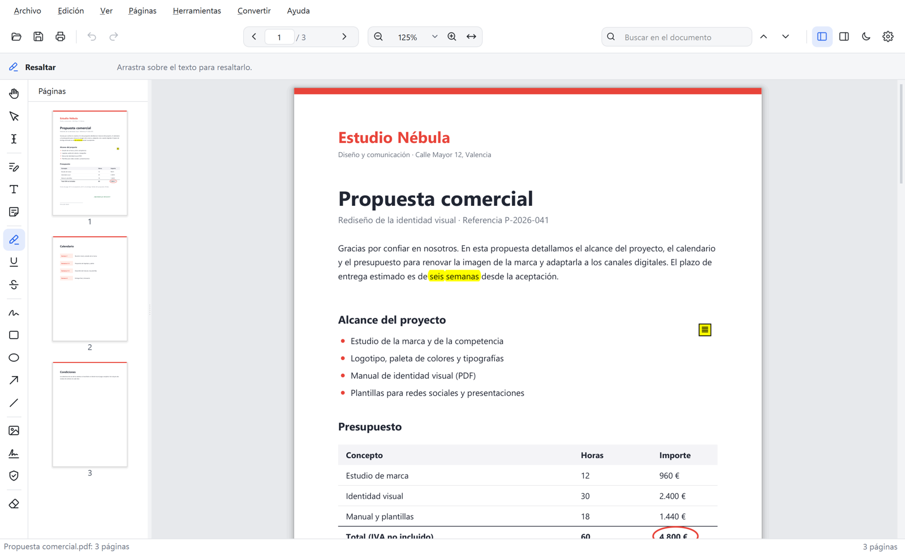
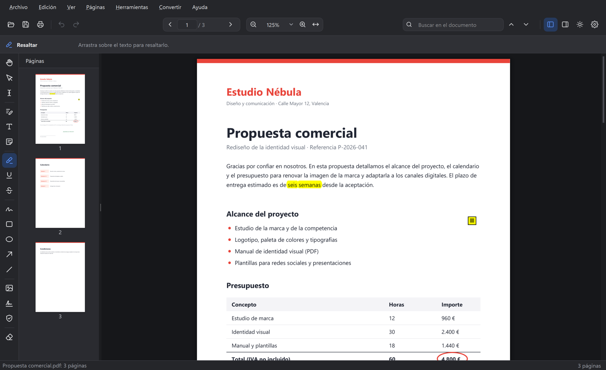

# PDFácil

Visor y editor de PDF para Windows 10 y 11, de **Agencia Daga**.



## Instalar
1. Descarga `PDFacil-<versión>-instalador.exe` de la página de [versiones](../../releases/latest).
2. Ábrelo. Si Windows muestra «Windows protegió su PC», pulsa **Más información > Ejecutar de todas formas**
   (el instalador no lleva firma de código).
3. Se instala para tu usuario, sin permisos de administrador.

El programa busca actualizaciones al iniciarse y, si hay una versión nueva, ofrece instalarla
(se puede desactivar en Ajustes).

## Qué hace
- **Ver:** vista continua, zoom, miniaturas, búsqueda, tema claro u oscuro.
- **Páginas:** girar, eliminar, duplicar, insertar, reordenar arrastrando, extraer, dividir y combinar.
- **Anotar:** resaltar, subrayar, tachar, texto, notas, dibujo, formas, imágenes y firma manuscrita.
- **Editar texto** del propio PDF y **borrar zonas** para siempre.
- **Formularios:** rellenar los campos.
- **Firma digital** con certificado (FNMT, DNIe) desde el almacén de Windows, con sello de tiempo
  y validación a largo plazo, y verificación de firmas.
- **OCR** y **corrector ortográfico** con los motores de Windows (en español, sin instalar nada).
- **Convertir:** PDF a imágenes o texto, imágenes a PDF y comprimir.
- **Seguridad:** abrir PDF protegidos y poner o quitar contraseña.
- Se puede elegir como programa predeterminado para los PDF (Ajustes > Archivos PDF).
- Tema claro y oscuro:



## Desarrollo
Python 3.11 + PySide6 + PyMuPDF + pyHanko.

```
py -3.11 -m venv .venv
.venv\Scripts\pip install pyside6 pymupdf pyinstaller "pyhanko[image-support,opentype]" pyhanko-certvalidator ^
    fonttools comtypes truststore winrt-runtime winrt-Windows.Media.Ocr winrt-Windows.Graphics.Imaging ^
    winrt-Windows.Storage.Streams winrt-Windows.Globalization winrt-Windows.Foundation ^
    winrt-Windows.Foundation.Collections
.venv\Scripts\python main.py
```

- Compilar el programa y el instalador: `.venv\Scripts\python build.py`. Necesita Inno Setup 6
  (`winget install JRSoftware.InnoSetup`).
- Pruebas: `tests\prueba_auto.py`, `tests\prueba_ortografia.py`, `tests\prueba_actualizacion.py`, `tests\capturas_dialogos.py`.
- Imágenes (icono, instalador, GitHub): `tools\generar_imagenes.py` (lo llama `build.py`). PDF de ejemplo: `tools\demo_pdf.py`.

### Publicar una versión nueva
1. Sube `__version__` en `editor_pdf/__init__.py` y añade sus novedades en `NOVEDADES.md`.
2. `.venv\Scripts\python build.py`
3. Haz commit y push.
4. `.venv\Scripts\python publicar.py`: crea la versión en GitHub con el instalador. Los programas
   instalados la verán en su próxima comprobación.

© 2026 Agencia Daga
